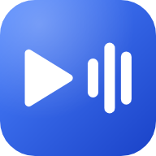

<p align="center">
  
</p>

<h1 align="center">YouTube to MP3 &amp; MP4</h1>

<p align="center">
  Turn YouTube videos into tagged MP3 audio or MP4 video, entirely on your own computer.<br>
  Ubah video YouTube menjadi audio MP3 atau video MP4 lengkap dengan tag, sepenuhnya di komputermu sendiri.
</p>

<p align="center">
  <a href="https://github.com/irfanadwifangga/yt-to-mp3/releases/latest"></a>
  <a href="LICENSE"></a>
</p>

<p align="center">
  <a href="https://yt-to-mp3.irvan.dev">Website</a> ·
  <a href="#download--unduh">Download</a> ·
  <a href="docs/README.en.md">Documentation (English)</a> ·
  <a href="docs/README.id.md">Dokumentasi (Bahasa Indonesia)</a> ·
  <a href="CODE_OF_CONDUCT.md">Code of Conduct</a> ·
  <a href="CONTRIBUTING.md">Contributing</a>
</p>

---

## English

YouTube to MP3 & MP4 is a desktop app that runs locally: paste a YouTube link, check the preview, and get an MP3 with the title, artist, cover art, and (for YouTube Music tracks) album and release year already filled in, or an MP4 video from 360p up to the best resolution available. Nothing is uploaded to a cloud service, and there is no account to create.

- **Paste and go** — analysis starts as soon as the link is complete.
- **Audio or video, in many formats** — MP3, M4A, Opus, OGG, FLAC, or WAV; MP4, MKV, MOV, WebM, AVI, or FLV.
- **Preview and trim** — play the source, pick a start and end, and convert just that clip.
- **Playlists** — pick all or some videos from a playlist and queue them in one go.
- **Clean tags** — title and artist suggestions without clutter like `(Official Video)`, editable before converting.
- **A real queue** — live progress, cancel, automatic retries, and a history of finished files.
- **Its own window on Windows**, with a one-click installer and no admin rights required.
- **Tools managed for you** — yt-dlp and FFmpeg are installed and verified from inside the app.

Read the [full documentation](docs/README.en.md) for installation, usage, development, and architecture.

## Bahasa Indonesia

YouTube to MP3 & MP4 adalah aplikasi desktop yang berjalan lokal: tempel tautan YouTube, periksa pratinjaunya, lalu dapatkan MP3 dengan judul, artis, sampul, dan (untuk lagu YouTube Music) album serta tahun rilis yang sudah terisi, atau video MP4 dari 360p sampai resolusi terbaik yang tersedia. Tidak ada yang diunggah ke layanan cloud, dan tidak perlu membuat akun.

- **Tempel dan jalan** — analisis dimulai begitu tautannya lengkap.
- **Audio atau video, dalam banyak format** — MP3, M4A, Opus, OGG, FLAC, atau WAV; MP4, MKV, MOV, WebM, AVI, atau FLV.
- **Pratinjau dan potong** — putar sumbernya, tentukan awal dan akhir, lalu konversi klip itu saja.
- **Playlist** — pilih semua atau sebagian video dari playlist dan masukkan ke antrean sekaligus.
- **Tag yang rapi** — saran judul dan artis tanpa embel-embel seperti `(Official Video)`, bisa disunting sebelum konversi.
- **Antrean konversi** — progres langsung, pembatalan, percobaan ulang otomatis, dan riwayat berkas yang selesai.
- **Jendela sendiri di Windows**, dengan pemasang sekali klik tanpa hak admin.
- **Perkakas dikelola aplikasi** — yt-dlp dan FFmpeg dipasang dan diverifikasi dari dalam aplikasi.

Baca [dokumentasi lengkap](docs/README.id.md) untuk instalasi, cara pakai, pengembangan, dan arsitektur.

---

## Download / Unduh

Get the latest version from the [official website](https://yt-to-mp3.irvan.dev) or the [Releases page](https://github.com/irfanadwifangga/yt-to-mp3/releases/latest). / Ambil versi terbaru dari [situs resmi](https://yt-to-mp3.irvan.dev) atau [halaman Releases](https://github.com/irfanadwifangga/yt-to-mp3/releases/latest).

| Platform | File | Notes / Catatan |
| --- | --- | --- |
| Windows (recommended / disarankan) | `yt-to-mp3_<version>_windows_amd64_setup.exe` | Installer, no admin rights needed / tanpa hak admin |
| Windows (portable) | `yt-to-mp3_<version>_windows_amd64.zip` | Extract and run / ekstrak lalu jalankan |
| macOS | `yt-to-mp3_<version>_darwin_arm64.tar.gz` · `…_darwin_amd64.tar.gz` | Apple Silicon · Intel |
| Linux | `yt-to-mp3_<version>_linux_amd64.tar.gz` · `…_linux_arm64.tar.gz` | x86-64 · ARM64 |

**Verify before running. / Verifikasi sebelum menjalankan.** Every release includes `checksums.txt` (SHA-256), and the Windows installer also has its own `.sha256` file. / Setiap rilis menyertakan `checksums.txt` (SHA-256), dan installer Windows punya berkas `.sha256` sendiri.

```powershell
# Windows (PowerShell)
Get-FileHash .\yt-to-mp3_<version>_windows_amd64_setup.exe -Algorithm SHA256
```

```bash
# Linux
sha256sum -c checksums.txt --ignore-missing

# macOS (compare the two lines by eye / bandingkan kedua baris)
shasum -a 256 yt-to-mp3_<version>_darwin_arm64.tar.gz
grep darwin_arm64 checksums.txt
```

**The binaries are not signed yet. / Berkas program belum ditandatangani.** On Windows, SmartScreen may show "Windows protected your PC": verify the checksum first, then choose **More info** → **Run anyway**. On macOS, run `xattr -d com.apple.quarantine ./yt-to-mp3` after extracting. / Di Windows, SmartScreen mungkin menampilkan peringatan: verifikasi checksum dulu, lalu pilih **More info** → **Run anyway**. Di macOS, jalankan `xattr -d com.apple.quarantine ./yt-to-mp3` setelah ekstrak.

**First run / Pertama kali dipakai.** yt-dlp and FFmpeg are not bundled. Install them from **Settings → Tools** inside the app. / yt-dlp dan FFmpeg tidak ikut dibundel. Pasang dari **Settings → Tools** di dalam aplikasi.

---

## Third-party software / Perangkat lunak pihak ketiga

yt-dlp and FFmpeg are separate projects under their own licenses (yt-dlp: Unlicense; FFmpeg: LGPL or GPL depending on the build). They are never included in this project's release files; the app downloads them on your request. This project is not affiliated with or endorsed by YouTube or Google. / yt-dlp dan FFmpeg adalah proyek terpisah dengan lisensinya sendiri (yt-dlp: Unlicense; FFmpeg: LGPL atau GPL tergantung build-nya). Keduanya tidak pernah disertakan di berkas rilis proyek ini; aplikasi mengunduhnya atas permintaanmu. Proyek ini tidak berafiliasi dengan atau didukung oleh YouTube maupun Google.

---

Semua peserta wajib mengikuti [Kode Etik Komunitas](CODE_OF_CONDUCT.md). / All participants must follow the [Code of Conduct](CODE_OF_CONDUCT.md).

Downloading YouTube content generally violates YouTube's Terms of Service, and copyright stays with the owners of the material. This project is a local, personal tool. / Mengunduh konten YouTube umumnya melanggar Terms of Service YouTube, dan hak cipta tetap milik pemilik materi. Proyek ini adalah alat lokal untuk pemakaian pribadi.

Licensed under [MIT](LICENSE). / Berlisensi [MIT](LICENSE).
